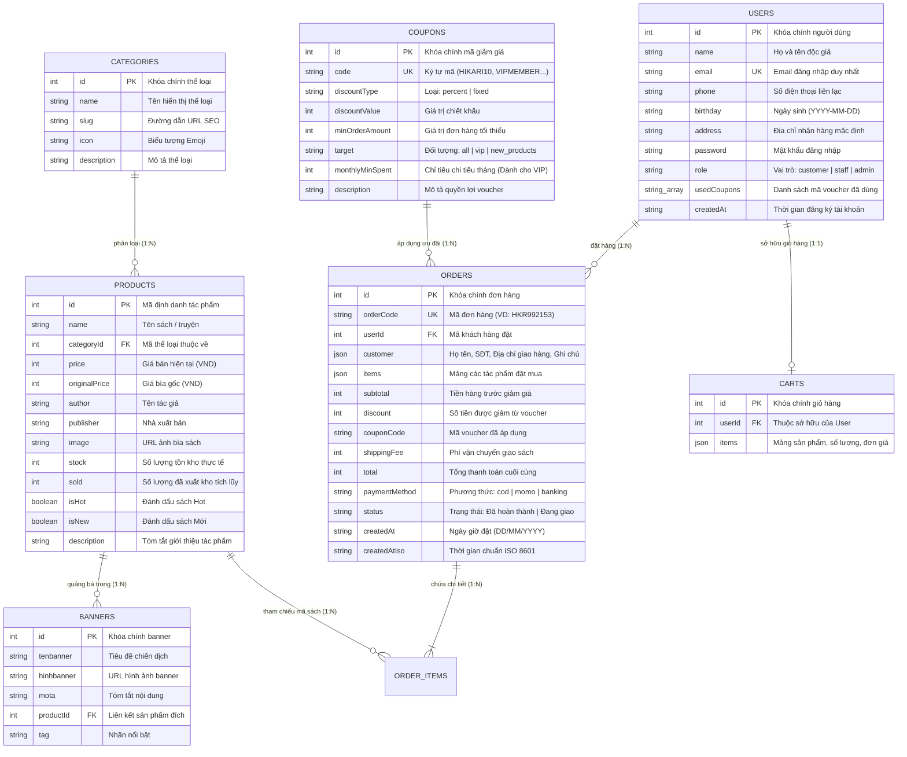

# 🗄️ TÀI LIỆU THIẾT KẾ CƠ SỞ DỮ LIỆU (DATABASE SPECIFICATION)
## DỰ ÁN: HIKARI BOOKSTORE - WEBSITE THƯƠNG MẠI ĐIỆN TỬ MANGA & LIGHT NOVEL
> **Môn học:** Đồ án kết thúc học phần Lập trình JavaScript  
> **Cơ sở dữ liệu:** Mock RESTful JSON Database (`db.json`) & Browser `localStorage`  
> **Mô hình kiến trúc:** Quan hệ thực thể chuẩn hóa (Relational Entity Model)  

---

## 📑 MỤC LỤC
1. [Sơ Đồ Quan Hệ Thực Thể (Entity-Relationship Diagram - ERD)](#1-sơ-đồ-quan-hệ-thực-thể-entity-relationship-diagram---erd)
2. [Chi Tiết Lược Đồ Dữ Liệu Các Bảng (Collections Schema)](#2-chi-tiết-lược-đồ-dữ-liệu-các-bảng-collections-schema)
   - [2.1. Bảng `categories` (Danh Mục Thể Loại)](#21-bảng-categories-danh-mục-thể-loại)
   - [2.2. Bảng `banners` (Banner Chiến Dịch)](#22-bảng-banners-banner-chiến-dịch)
   - [2.3. Bảng `coupons` (Mã Phiếu Giảm Giá)](#23-bảng-coupons-mã-phiếu-giảm-giá)
   - [2.4. Bảng `products` (Kho Tác Phẩm & Truyện Tranh)](#24-bảng-products-kho-tác-phẩm--truyện-tranh)
   - [2.5. Bảng `users` (Tài Khoản Người Dùng & Phân Quyền)](#25-bảng-users-tài-khoản-người-dùng--phân-quyền)
   - [2.6. Bảng `orders` (Hóa Đơn & Đơn Đặt Hàng)](#26-bảng-orders-hóa-đơn--đơn-đặt-hàng)
   - [2.7. Bảng `carts` (Giỏ Hàng Đồng Bộ Máy Chủ)](#27-bảng-carts-giỏ-hàng-đồng-bộ-máy-chủ)
3. [Đặc Tả Quan Hệ Giữa Các Thực Thể (Relationships)](#3-đặc-tả-quan-hệ-giữa-các-thực-thể-relationships)
4. [Cấu Trúc Lưu Trữ Bộ Nhớ Đệm Phía Trình Duyệt (`localStorage`)](#4-cấu-trúc-lưu-trữ-bộ-nhớ-đệm-phía-trình-duyệt-localstorage)
5. [Quy Tắc Toàn Vẹn & Ràng Buộc Dữ Liệu (Integrity Constraints)](#5-quy-tắc-toàn-vẹn--ràng-buộc-dữ-liệu-integrity-constraints)

---

## 1. SƠ ĐỒ QUAN HỆ THỰC THỂ (ENTITY-RELATIONSHIP DIAGRAM - ERD)

Toàn bộ hệ sinh thái dữ liệu của Hikari BookStore được chuẩn hóa quan hệ logic như sau:



---

## 2. CHI TIẾT LƯỢC ĐỒ DỮ LIỆU CÁC BẢNG (COLLECTIONS SCHEMA)

### 2.1. Bảng `categories` (Danh Mục Thể Loại)
Lưu trữ danh sách các danh mục thể loại phân loại sách trong cửa hàng.

| Tên Cột (Field) | Kiểu Dữ Liệu | Ràng Buộc | Mô Tả & Ý Nghĩa Nghiệp Vụ |
| :--- | :--- | :--- | :--- |
| `id` | `Integer` | **PK**, Auto Increment | Mã định danh duy nhất của thể loại (1, 2, 3...) |
| `name` | `String` | Required, Not Null | Tên hiển thị (VD: *Manga - Truyện Tranh*, *Light Novel*) |
| `slug` | `String` | Required, Index | Đường dẫn rút gọn không dấu phục vụ URL và lọc (`manga`, `light-novel`) |
| `icon` | `String` | Optional | Ký tự Emoji đại diện trực quan trên menu (`📚`, `✨`, `📖`) |
| `description` | `String` | Optional | Đoạn giới thiệu ngắn về đặc trưng thể loại sách |

**Ví Dụ Dữ Liệu JSON Mẫu:**
```json
{
  "id": 1,
  "name": "Manga - Truyện Tranh",
  "slug": "manga",
  "icon": "📚",
  "description": "Các bộ truyện tranh Nhật Bản kinh điển và mới nhất"
}
```

---

### 2.2. Bảng `banners` (Banner Chiến Dịch)
Lưu trữ thông tin các slide trình chiếu quảng bá tác phẩm trên trang chủ (`index.html`).

| Tên Cột (Field) | Kiểu Dữ Liệu | Ràng Buộc | Mô Tả & Ý Nghĩa Nghiệp Vụ |
| :--- | :--- | :--- | :--- |
| `id` | `Integer` | **PK**, Auto Increment | Mã định danh banner |
| `tenbanner` | `String` | Required | Tiêu đề chiến dịch marketing ra mắt ấn phẩm |
| `hinhbanner` | `String` | Required (URL) | Đường dẫn ảnh độ phân giải cao phục vụ hiển thị Hero Banner |
| `mota` | `String` | Optional | Nội dung mô tả ngắn gọn về tình tiết hoặc sự kiện tác phẩm |
| `productId` | `Integer` | **FK** (`products.id`) | Mã tác phẩm liên kết, khi bấm vào banner sẽ chuyển tới chi tiết sách |
| `tag` | `String` | Optional | Nhãn phụ nổi bật (VD: *"Sản Phẩm Mới Ra Mắt ✨"*) |

---

### 2.3. Bảng `coupons` (Mã Phiếu Giảm Giá)
Quản lý danh sách mã ưu đãi, voucher chào mừng và đặc quyền thành viên VIP.

| Tên Cột (Field) | Kiểu Dữ Liệu | Ràng Buộc | Mô Tả & Ý Nghĩa Nghiệp Vụ |
| :--- | :--- | :--- | :--- |
| `id` | `Integer` | **PK**, Auto Increment | Mã định danh phiếu ưu đãi |
| `code` | `String` | Required, **Unique** | Ký tự mã viết hoa (`WELCOME20`, `HIKARI10`, `VIPMEMBER`) |
| `discountType`| `String` | Enum (`percent`, `fixed`) | Phương thức giảm: Theo phần trăm (`percent`) hoặc số tiền cố định |
| `discountValue`| `Integer`| Required, Min = 1 | Giá trị giảm (Ví dụ: `15` tức là giảm 15%) |
| `minOrderAmount`| `Integer`| Default = 0 | Giá trị đơn hàng tối thiểu bắt buộc để có thể kích hoạt mã |
| `target` | `String` | Enum (`all`, `vip`, `new_products`) | Đối tượng: Mọi độc giả (`all`), Sách mới (`new_products`), Thành viên VIP (`vip`) |
| `monthlyMinSpent`| `Integer`| Nullable | Mốc chi tiêu tối thiểu trong tháng để dùng mã (VD: 500.000đ cho VIP) |
| `description` | `String` | Required | Nội dung hiển thị hướng dẫn khách hàng cách sử dụng |

**Ví Dụ Dữ Liệu JSON Mẫu (`VIPMEMBER`):**
```json
{
  "id": 4,
  "code": "VIPMEMBER",
  "discountType": "percent",
  "discountValue": 15,
  "minOrderAmount": 0,
  "target": "vip",
  "monthlyMinSpent": 500000,
  "maintainMinSpent": 250000,
  "description": "Giảm 15% tổng hóa đơn dành riêng cho Thành Viên VIP (chi tiêu ≥ 500.000đ/tháng hoặc duy trì từ tháng trước)"
}
```

---

### 2.4. Bảng `products` (Kho Tác Phẩm & Truyện Tranh)
Bảng cốt lõi quản lý toàn bộ danh mục hàng hóa của nhà sách Hikari.

| Tên Cột (Field) | Kiểu Dữ Liệu | Ràng Buộc | Mô Tả & Ý Nghĩa Nghiệp Vụ |
| :--- | :--- | :--- | :--- |
| `id` | `Integer` | **PK**, Auto Increment | Mã định danh duy nhất của từng cuốn sách |
| `name` | `String` | Required, Index | Tên đầy đủ của tác phẩm (Kèm tập phát hành) |
| `categoryId` | `Integer` | **FK** (`categories.id`) | Khóa ngoại trỏ đến danh mục thể loại |
| `price` | `Integer` | Required, Min = 0 | Giá bán thực tế hiện tại đến tay độc giả (VND) |
| `originalPrice`| `Integer`| Min = 0 | Giá bìa niêm yết của Nhà xuất bản (VND) |
| `author` | `String` | Required | Tên tác giả sáng tác hoặc vẽ minh họa |
| `publisher` | `String` | Required | Nhà xuất bản phát hành (NXB Kim Đồng, NXB Trẻ, IPM...) |
| `image` | `String` | Required (URL) | Link ảnh bìa sách chất lượng cao |
| `stock` | `Integer` | Required, Min = 0 | Số lượng tồn kho sẵn sàng xuất bán |
| `sold` | `Integer` | Default = 0 | Số lượng sách đã bán ra (Tích lũy lịch sử) |
| `isHot` | `Boolean` | Default = `false` | Đánh dấu sách bán chạy / được quan tâm cao |
| `isNew` | `Boolean` | Default = `false` | Đánh dấu sách mới phát hành (Áp dụng được mã `NEWBOOKS`) |
| `description` | `String` | Text (Dài) | Nội dung tóm tắt giới thiệu tác phẩm |

---

### 2.5. Bảng `users` (Tài Khoản Người Dùng & Phân Quyền)
Quản lý thông tin đăng ký, thông tin liên lạc và vai trò trong hệ thống.

| Tên Cột (Field) | Kiểu Dữ Liệu | Ràng Buộc | Mô Tả & Ý Nghĩa Nghiệp Vụ |
| :--- | :--- | :--- | :--- |
| `id` | `Integer` | **PK**, Auto Increment | Mã định danh khách hàng / nhân viên |
| `name` | `String` | Required | Họ và tên đầy đủ |
| `email` | `String` | Required, **Unique** | Email định danh đăng nhập hệ thống |
| `phone` | `String` | Regex Validation | Số điện thoại liên lạc nhận hàng (10 chữ số) |
| `birthday` | `String` | Format: `YYYY-MM-DD` | Ngày sinh nhật phục vụ tặng quà ưu đãi sinh nhật |
| `address` | `String` | Nullable | **Địa chỉ nhận hàng mặc định** (Tự động điền khi checkout) |
| `password` | `String` | Required, MinLen = 6 | Mật khẩu tài khoản |
| `role` | `String` | Enum (`customer`, `staff`, `admin`) | Phân quyền: Độc giả (`customer`), Nhân viên (`staff`), Quản trị (`admin`) |
| `usedCoupons` | `Array[String]` | Default = `[]` | Danh sách các mã voucher chỉ được dùng 1 lần (như `WELCOME20`) |
| `createdAt` | `String` | Timestamp | Thời điểm tạo tài khoản độc giả |

---

### 2.6. Bảng `orders` (Hóa Đơn & Đơn Đặt Hàng)
Lưu trữ toàn bộ lịch sử mua sắm, thông tin giao hàng và căn cứ tính cấp bậc VIP theo tháng.

| Tên Cột (Field) | Kiểu Dữ Liệu | Ràng Buộc | Mô Tả & Ý Nghĩa Nghiệp Vụ |
| :--- | :--- | :--- | :--- |
| `id` | `Integer` / `Long` | **PK**, Timestamp | Mã định danh bản ghi đơn hàng |
| `orderCode` | `String` | **Unique**, Index | Mã đơn hàng hiển thị trực quan (VD: `HKR992153`) |
| `userId` | `Integer` | **FK** (`users.id`) | Khóa ngoại xác định người đặt hàng |
| `customer` | `Object` | Required | Gồm: `name` (tên nhận), `phone` (SĐT), `address` (địa chỉ nhận), `note` |
| `items` | `Array[Object]` | Required, MinLen = 1 | Mảng chi tiết từng cuốn sách: `productId`, `name`, `price`, `quantity`, `image` |
| `subtotal` | `Integer` | Required | Tổng tiền sách tạm tính trước khi áp voucher |
| `discount` | `Integer` | Default = 0 | Số tiền được khấu trừ từ mã giảm giá |
| `couponCode` | `String` | Nullable | Mã khuyến mãi đã áp dụng cho đơn |
| `shippingFee` | `Integer` | Default = 30000 | Cước phí vận chuyển (0đ nếu đơn từ 250k) |
| `total` | `Integer` | Required | Tổng số tiền thanh toán cuối cùng |
| `paymentMethod`| `String` | Enum (`cod`, `momo`, `banking`) | Phương thức thanh toán khách đã lựa chọn |
| `status` | `String` | Default = `Đã hoàn thành` | Trạng thái xử lý: `Đã hoàn thành`, `Đang giao`, `Đã hủy` |
| `createdAt` | `String` | Format: `HH:mm:ss DD/MM/YYYY` | Ngày giờ đặt đơn phục vụ in hóa đơn |
| `createdAtIso` | `String` | Format: ISO 8601 | Thời gian chuẩn dùng cho bộ lọc Ngày/Tháng/Quý/Năm |

**Ví Dụ Cấu Trúc Bản Ghi Đơn Hàng Hoàn Chỉnh:**
```json
{
  "id": 1793758226259,
  "orderCode": "HKR992153",
  "userId": 3,
  "customer": {
    "name": "Nguyễn Thị Mai",
    "phone": "0988776655",
    "address": "123 Đường Sách Nguyễn Huệ, Quận 1, TP.HCM",
    "note": "Bọc sách cẩn thận giúp mình"
  },
  "items": [
    {
      "productId": 2,
      "name": "Jujutsu Kaisen - Chú Thuật Hồi Chiến - Tập 24",
      "price": 40500,
      "originalPrice": 45000,
      "quantity": 29
    }
  ],
  "subtotal": 1174500,
  "discount": 0,
  "couponCode": "",
  "shippingFee": 0,
  "total": 1174500,
  "paymentMethod": "cod",
  "status": "Đã hoàn thành",
  "createdAt": "09:10:26 04/11/2026",
  "createdAtIso": "2026-11-04T02:10:26.262Z"
}
```

---

### 2.7. Bảng `carts` (Giỏ Hàng Đồng Bộ Máy Chủ)
Lưu trữ các mục hàng đang chọn của người dùng trên server nhằm hỗ trợ đăng nhập nhiều thiết bị.

| Tên Cột (Field) | Kiểu Dữ Liệu | Ràng Buộc | Mô Tả & Ý Nghĩa Nghiệp Vụ |
| :--- | :--- | :--- | :--- |
| `id` | `Integer` | **PK**, Auto Increment | Mã định danh bản ghi giỏ |
| `userId` | `Integer` | **FK** (`users.id`) | Khóa ngoại gắn với tài khoản người dùng |
| `productId` | `Integer` | **FK** (`products.id`)| Mã tác phẩm được thêm |
| `name` | `String` | Required | Tên sách tại thời điểm thêm |
| `price` | `Integer` | Required | Đơn giá sản phẩm |
| `quantity` | `Integer` | Min = 1 | Số lượng đặt mua hiện tại trong giỏ |

---

## 3. ĐẶC TẢ QUAN HỆ GIỮA CÁC THỰC THỂ (RELATIONSHIPS)

1. **Quan hệ Danh Mục - Sản Phẩm (`categories` $\rightarrow$ `products`):**
   - Mối quan hệ **1 - N (One-to-Many)**.
   - Một thể loại (Category) có thể chứa nhiều tác phẩm sách khác nhau.
   - Mỗi cuốn sách bắt buộc phải thuộc về một thể loại cụ thể thông qua khóa ngoại `products.categoryId`.

2. **Quan hệ Người Dùng - Đơn Hàng (`users` $\rightarrow$ `orders`):**
   - Mối quan hệ **1 - N (One-to-Many)**.
   - Một độc giả đã đăng ký tài khoản có thể thực hiện nhiều đơn hàng xuyên suốt quá trình mua sắm.
   - Mỗi đơn hàng lưu trữ `orders.userId` làm căn cứ để tính toán tổng chi tiêu tích lũy và xét duyệt cấp bậc VIP theo tháng.

3. **Quan hệ Đơn Hàng - Chi Tiết Sách (`orders` $\rightarrow$ `products`):**
   - Mối quan hệ **N - N (Many-to-Many)** được chuẩn hóa thông qua mảng cấu trúc nhúng `orders.items[]`.
   - Mỗi đơn hàng chứa nhiều sách với số lượng tương ứng; ngược lại, một cuốn sách có thể xuất hiện trong nhiều đơn hàng khác nhau.

4. **Quan hệ Banner - Sản Phẩm (`banners` $\rightarrow$ `products`):**
   - Mối quan hệ **N - 1 (Many-to-One)**.
   - Mỗi banner quảng bá trỏ trực tiếp đến `productId` của cuốn sách trọng tâm để khi khách click vào sẽ điều hướng thẳng đến trang chi tiết sản phẩm.

---

## 4. CẤU TRÚC LƯU TRỮ BỘ NHỚ ĐỆM PHÍA TRÌNH DUYỆT (`localStorage`)

Nhằm tối ưu hóa tốc độ tải trang và đảm bảo tính khả dụng ngay cả khi kết nối mạng chập chờn, hệ thống quy chuẩn các Key lưu trữ sau trong `localStorage`:

| Tên Key | Cấu Trúc Dữ Liệu | Mục Đích Lưu Trữ & Vòng Đời |
| :--- | :--- | :--- |
| `user` | `JSON Object` | Lưu thông tin người dùng đang đăng nhập (`id`, `name`, `email`, `phone`, `birthday`, `address`, `role`). Bị xóa khi bấm "Đăng xuất". |
| `currentUser` | `JSON Object` | Bản sao dự phòng đồng bộ cho phiên làm việc người dùng. |
| `cart` | `JSON Array[Object]` | Lưu trữ danh sách sản phẩm trong giỏ hàng ngoại tuyến. Tự động phục hồi giỏ hàng sau khi người dùng F5 tải lại trang. |
| `orders` | `JSON Array[Object]` | Cache danh sách đơn hàng dự phòng khi JSON-Server không phản hồi. |
| `used_coupons_{userId}` | `JSON Array[String]` | Đánh dấu các mã voucher 1 lần (như `WELCOME20`) đã được tài khoản sử dụng để chống lạm dụng khuyến mãi. |

---

## 5. QUY TẮC TOÀN VẸN & RÀNG BUỘC DỮ LIỆU (INTEGRITY CONSTRAINTS)

1. **Ràng Buộc Khóa Chính & Tính Duy Nhất (Uniqueness):**
   - Trường `email` trong bảng `users` là duy nhất, không cho phép hai tài khoản trùng email.
   - Trường `orderCode` trong bảng `orders` được tạo với tiền tố `HKR` kèm chuỗi số ngẫu nhiên 6 chữ số, đảm bảo không trùng lặp mã chứng từ kế toán.
2. **Ràng Buộc Tồn Kho Thực Tế (Stock Non-Negative Constraint):**
   - Trường `stock` trong `products` không bao giờ được phép âm (`stock >= 0`).
   - Nghiệp vụ đặt hàng bắt buộc phải kiểm tra `stock >= quantity` trước khi tạo đơn hàng mới.
3. **Cơ Chế Trừ Kho Tự Động (Stock Decrement):**
   - Khi đơn hàng hoàn tất (`POST /orders`), hệ thống tự động phát lệnh `PATCH /products/:id` để trừ bớt số lượng tồn kho theo số lượng đã mua, đồng thời tăng giá trị `sold` lên tương ứng.
4. **Tính Nhất Quán Về Giá (Price Integrity):**
   - Giá bán thực tế không được phép lớn hơn giá bìa gốc (`price <= originalPrice`).
   - Mọi phép tính giảm giá `%` được làm tròn số nguyên gần nhất bằng hàm `Math.round()` để tránh phát sinh số lẻ thập phân.

---

> ✍️ **Biên soạn tài liệu bởi:** Nhóm phát triển dự án Hikari BookStore  
> 📌 **Tài liệu thuộc bộ hồ sơ đồ án:** Môn Lập trình JavaScript (Vanilla JS & ES6+)

