# 🏗️ TÀI LIỆU THIẾT KẾ KIẾN TRÚC PHẦN MỀM (SOFTWARE ARCHITECTURE DESIGN)
## DỰ ÁN: HIKARI BOOKSTORE - NỀN TẢNG THƯƠNG MẠI ĐIỆN TỬ MANGA & LIGHT NOVEL
> **Môn học:** Đồ án kết thúc học phần Lập trình JavaScript  
> **Kiến trúc:** 3-Tier Layered Architecture & Modular ES6+ Components  
> **Nguyên tắc kỹ thuật:** Không dùng Framework (Pure Vanilla JavaScript ES6+)  
> **Tiêu chuẩn thiết kế:** Site Map, Functional Decomposition (BFD), Use Case Diagram, DFD Cấp 0 & 1, Deployment Diagram, State Machine Diagram  

---

## 📑 MỤC LỤC
1. [Tổng Quan Kiến Trúc & Mục Tiêu Thiết Kế Kỹ Thuật](#1-tổng-quan-kiến-trúc--mục-tiêu-thiết-kế-kỹ-thuật)
2. [Sơ Đồ Cấu Trúc Website & Điều Hướng (Site Map / Navigation Flow)](#2-sơ-đồ-cấu-trúc-website--điều-hướng-site-map--navigation-flow)
3. [Sơ Đồ Phân Rã Chức Năng Hệ Thống (Functional Decomposition Diagram - BFD)](#3-sơ-đồ-phân-rã-chức-năng-hệ-thống-functional-decomposition-diagram---bfd)
4. [Sơ Đồ Ca Sử Dụng Tổng Thể & Chi Tiết (System Use Case Diagrams)](#4-sơ-đồ-ca-sử-dụng-tổng-thể--chi-tiết-system-use-case-diagrams)
   - [4.1. Sơ đồ Use Case Tổng Thể Hệ Thống](#41-sơ-đồ-use-case-tổng-thể-hệ-thống)
   - [4.2. Sơ đồ Use Case Chi Tiết Phân Hệ Khách Hàng (Customer)](#42-sơ-đồ-use-case-chi-tiết-phân-hệ-khách-hàng-customer)
   - [4.3. Sơ đồ Use Case Chi Tiết Phân Hệ Quản Trị Viên & Kho (Admin / Staff)](#43-sơ-đồ-use-case-chi-tiết-phân-hệ-quản-trị-viên--kho-admin--staff)
5. [Sơ Đồ Luồng Dữ Liệu (Data Flow Diagram - DFD)](#5-sơ-đồ-luồng-dữ-liệu-data-flow-diagram---dfd)
   - [5.1. DFD Cấp 0 (Context Diagram - Sơ Đồ Ngữ Cảnh)](#51-dfd-cấp-0-context-diagram---sơ-đồ-ngữ-cảnh)
   - [5.2. DFD Cấp 1 (Phân Rã Các Tiến Trình Luồng Dữ Liệu Nghiệp Vụ)](#52-dfd-cấp-1-phân-rã-các-tiến-trình-luồng-dữ-liệu-nghiệp-vụ)
6. [Kiến Trúc Tổng Thể Hệ Thống 3 Tầng (3-Tier Layered Architecture)](#6-kiến-trúc-tổng-thể-hệ-thống-3-tầng-3-tier-layered-architecture)
7. [Phân Rã Hệ Thống & Cấu Trúc Module (Component & Class Diagram)](#7-phân-rã-hệ-thống--cấu-trúc-module-component--class-diagram)
8. [Sơ Đồ Triển Khai Hệ Thống Phần Mềm (Deployment Diagram)](#8-sơ-đồ-triển-khai-hệ-thống-phần-mềm-deployment-diagram)
9. [Sơ Đồ Máy Trạng Thái Nghiệp Vụ (State Machine Diagrams)](#9-sơ-đồ-máy-trạng-thái-nghiệp-vụ-state-machine-diagrams)
   - [9.1. Sơ Đồ Trạng Thái Vòng Đời Đơn Hàng (Order Lifecycle)](#91-sơ-đồ-trạng-thái-vòng-đời-đơn-hàng-order-lifecycle)
   - [9.2. Sơ Đồ Trạng Thái Chu Kỳ Tích Lũy & Duy Trì VIP Theo Tháng](#92-sơ-đồ-trạng-thái-chu-kỳ-tích-lũy--duy-trì-vip-theo-tháng)
10. [Các Mẫu Thiết Kế Phần Mềm Ứng Dụng (Software Design Patterns)](#10-các-mẫu-thiết-kế-phần-mềm-ứng-dụng-software-design-patterns)
    - [10.1. Mẫu Thiết Kế Module (Module Pattern)](#101-mẫu-thiết-kế-module-module-pattern)
    - [10.2. Mẫu Thiết Kế Mặt Tiền (Facade Pattern)](#102-mẫu-thiết-kế-mặt-tiền-facade-pattern)
    - [10.3. Mẫu Thiết Kế Hướng Sự Kiện (Observer / Event-Driven Pattern)](#103-mẫu-thiết-kế-hướng-sự-kiện-observer--event-driven-pattern)
    - [10.4. Mẫu Quản Lý Trạng Thái Cục Bộ (State Management Pattern)](#104-mẫu-quản-lý-trạng-thái-cục-bộ-state-management-pattern)
    - [10.5. Mẫu Chiến Lược Tính Toán (Strategy Pattern)](#105-mẫu-chiến-lược-tính-toán-strategy-pattern)
11. [Kiến Trúc Đa Trang (Multi-Page Application - MPA) & Tối Ưu Hóa Vite](#11-kiến-trúc-đa-trang-multi-page-application---mpa--tối-ưu-hóa-vite)
12. [Kiến Trúc Phân Quyền & Bảo Mật Ứng Dụng (Security & RBAC Architecture)](#12-kiến-trúc-phân-quyền--bảo-mật-ứng-dụng-security--rbac-architecture)
13. [Chiến Lược Chịu Lỗi & Tính Sẵn Sàng Cao (High Availability & Resilience)](#13-chiến-lược-chịu-lỗi--tính-sẵn-sàng-cao-high-availability--resilience)
14. [Kỹ Thuật Chuẩn Hóa Khung Nhìn Khi Xuất PDF (PDF Viewport Normalization)](#14-kỹ-thuật-chuẩn-hóa-khung-nhìn-khi-xuất-pdf-pdf-viewport-normalization)

---

## 1. TỔNG QUAN KIẾN TRÚC & MỤC TIÊU THIẾT KẾ KỸ THUẬT

Dự án **Hikari BookStore** được thiết kế để giải quyết trọn vẹn bài toán thực tế của sàn thương mại điện tử chuyên biệt cho Manga, Light Novel và Phụ kiện Anime. Hệ thống tối ưu hóa hiệu năng, giao diện mượt mà và khả năng mở rộng lâu dài, đáp ứng nghiêm ngặt 100% tiêu chí chấm điểm của đồ án kết thúc môn Lập trình JavaScript.

### 1.1. Các Ràng Buộc Kỹ Thuật Bắt Buộc
- **Không sử dụng Frontend Framework:** Toàn bộ vòng đời ứng dụng (Render, State, Event, Routing) được kiểm soát 100% bằng JavaScript thuần (Vanilla JS ES6+).
- **Tách biệt mối bận tâm (Separation of Concerns - SoC):** Tách bạch triệt để giữa mã cấu trúc (HTML5), mã định kiểu (CSS3), logic nghiệp vụ (JavaScript Modules) và tầng dữ liệu lưu trữ (JSON REST API & Storage).
- **Tuân thủ nguyên tắc SOLID:** Đặc biệt là *Single Responsibility Principle (SRP)*: Mỗi module JavaScript chỉ chịu trách nhiệm duy nhất cho một miền nghiệp vụ độc lập.

---

## 2. SƠ ĐỒ CẤU TRÚC WEBSITE & ĐIỀU HƯỚNG (SITE MAP / NAVIGATION FLOW)

Hệ thống được tổ chức theo kiến trúc Đa trang (Multi-Page Application - MPA) với luồng điều hướng tuyến tính, rõ ràng và thân thiện:

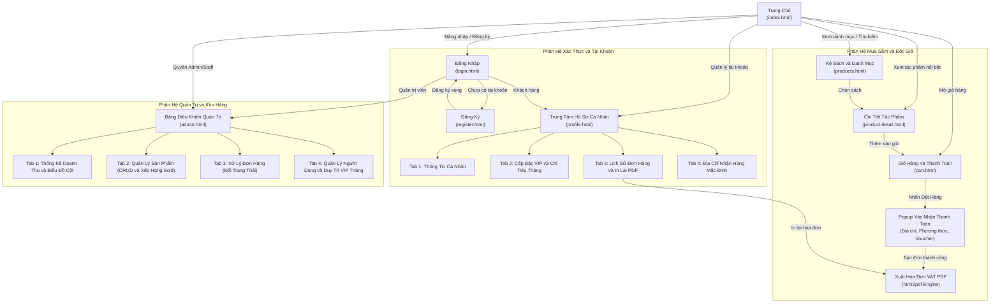

---

## 3. SƠ ĐỒ PHÂN RÃ CHỨC NĂNG HỆ THỐNG (FUNCTIONAL DECOMPOSITION DIAGRAM - BFD)

Toàn bộ năng lực chức năng của nền tảng thương mại điện tử Hikari BookStore được cấu trúc phân cấp:

```mermaid
flowchart TD
    Root["HỆ THỐNG THƯƠNG MẠI ĐIỆN TỬ HIKARI BOOKSTORE"]

    F_Client["1. PHÂN HỆ KHÁCH HÀNG (CLIENT / USER)"]
    F_Admin["2. PHÂN HỆ QUẢN TRỊ (ADMIN / STAFF)"]

    Root --> F_Client
    Root --> F_Admin

    %% Phân hệ Client
    F_Client --> C1["1.1. Xác Thực và Phân Quyền"]
    F_Client --> C2["1.2. Khám Phá và Tra Cứu Tác Phẩm"]
    F_Client --> C3["1.3. Giỏ Hàng và Khuyến Mãi"]
    F_Client --> C4["1.4. Đặt Hàng và Thanh Toán Linh Hoạt"]
    F_Client --> C5["1.5. Trung Tâm Hồ Sơ và Đặc Quyền VIP"]

    C1 --> C11["Đăng ký tài khoản (Regex validation)"]
    C1 --> C12["Đăng nhập và Ghi nhớ phiên LocalStorage"]
    C1 --> C13["Đăng xuất an toàn"]

    C2 --> C21["Tìm kiếm thời gian thực (Debounced Search)"]
    C2 --> C22["Lọc đa chiều song song (Thể loại, Giá, Hot, Mới)"]
    C2 --> C23["Sắp xếp (Giá tăng/giảm, Mới nhất, Bán chạy)"]
    C2 --> C24["Xem chi tiết sách và Trạng thái tồn kho"]

    C3 --> C31["Thêm/Bớt/Xóa sản phẩm trong giỏ"]
    C3 --> C32["Áp dụng mã giảm giá (Phần trăm, Tiền mặt, Sách mới)"]
    C3 --> C33["Nhận diện độc quyền voucher VIPMEMBER (-15%)"]

    C4 --> C41["Nhập địa chỉ nhận linh hoạt (Mặc định hoặc Nhập mới)"]
    C4 --> C42["Phương thức thanh toán (COD hoặc QR Momo/Bank)"]
    C4 --> C43["Tự động trừ tồn kho (stock) và cộng số bán (sold)"]
    C4 --> C44["Xuất hóa đơn VAT điện tử file PDF chuẩn A4"]

    C5 --> C51["Cập nhật thông tin cá nhân và Số điện thoại"]
    C5 --> C52["Lưu và chỉnh sửa địa chỉ nhận hàng mặc định"]
    C5 --> C53["Theo dõi tiến độ nâng hạng và duy trì VIP theo tháng"]
    C5 --> C54["Xem lịch sử đơn mua và In lại hóa đơn PDF"]

    %% Phân hệ Admin
    F_Admin --> A1["2.1. Thống Kê và Báo Cáo Doanh Thu"]
    F_Admin --> A2["2.2. Quản Trị Kho Hàng (CRUD)"]
    F_Admin --> A3["2.3. Xử Lý Đơn Đặt Hàng"]
    F_Admin --> A4["2.4. Quản Lý Khách Hàng và Duy Trì VIP"]

    A1 --> A11["Tổng hợp KPI (Doanh thu, Đơn hàng, Khách hàng, Tồn kho)"]
    A1 --> A12["Biểu đồ cột trực quan theo Ngày / Tháng / Quý / Năm"]
    A1 --> A13["Tỷ lệ hoàn thành đơn và tỷ lệ khách hàng VIP"]

    A2 --> A21["Thêm mới tác phẩm vào CSDL db.json"]
    A2 --> A22["Chỉnh sửa thông tin, giá bán, bìa sách, số tồn kho"]
    A2 --> A23["Xóa tác phẩm có hộp thoại xác nhận an toàn"]
    A2 --> A24["Tự động xếp hạng tác phẩm bán chạy (Top Best-Sellers)"]

    A3 --> A31["Xem danh sách đơn hàng toàn sàn"]
    A3 --> A32["Cập nhật tiến trình: Chờ xác nhận -> Đang xử lý -> Đang giao -> Đã giao"]
    A3 --> A33["Hủy đơn hàng và tự động hoàn trả số lượng tồn kho"]

    A4 --> A41["Xem danh bạ độc giả và Phân cấp vai trò (role)"]
    A4 --> A42["Theo dõi chi tiêu tháng và Đánh giá điều kiện duy trì VIP"]
```

---

## 4. SƠ ĐỒ CA SỬ DỤNG TỔNG THỂ & CHI TIẾT (SYSTEM USE CASE DIAGRAMS)

### 4.1. Sơ đồ Use Case Tổng Thể Hệ Thống

Hệ thống xác định 4 tác nhân chính (Actors):
1. **Khách vãng lai (Guest):** Người chưa đăng nhập tài khoản.
2. **Độc giả (Customer):** Khách hàng đã đăng nhập tài khoản.
3. **Nhân viên kho (Staff):** Phụ trách quản lý tồn kho và tiến trình giao hàng.
4. **Quản trị viên (Admin):** Người nắm giữ toàn quyền hệ thống.

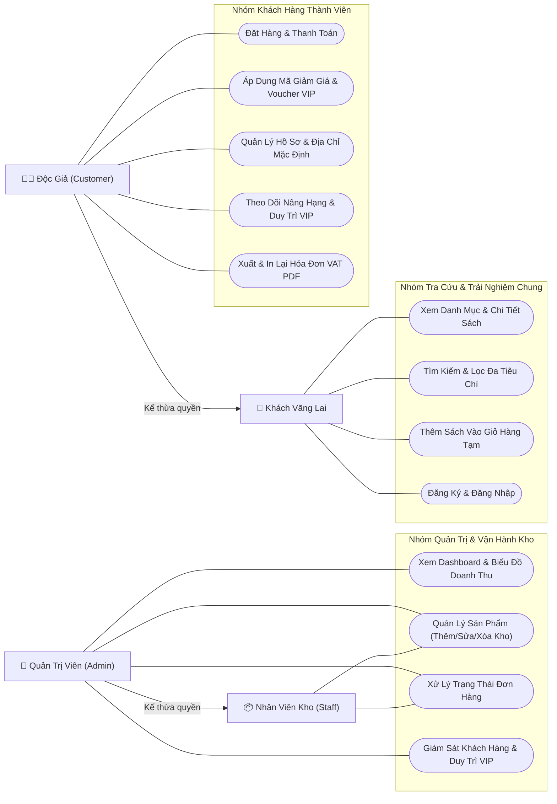

### 4.2. Sơ đồ Use Case Chi Tiết Phân Hệ Khách Hàng (Customer Subsystem)

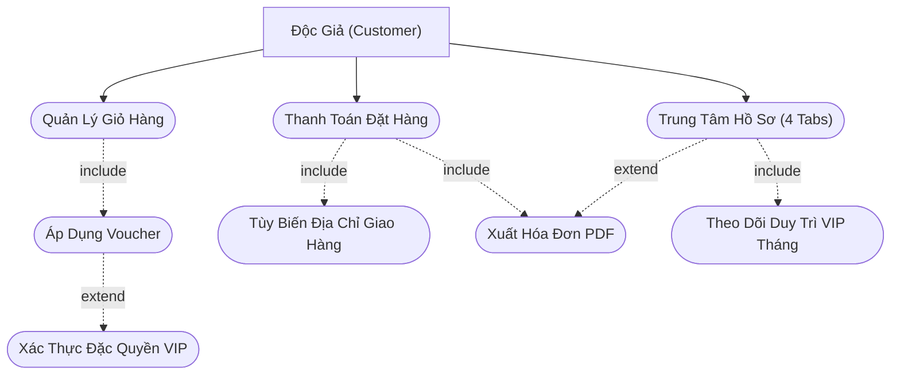

### 4.3. Sơ đồ Use Case Chi Tiết Phân Hệ Quản Trị Viên & Kho (Admin / Staff Subsystem)

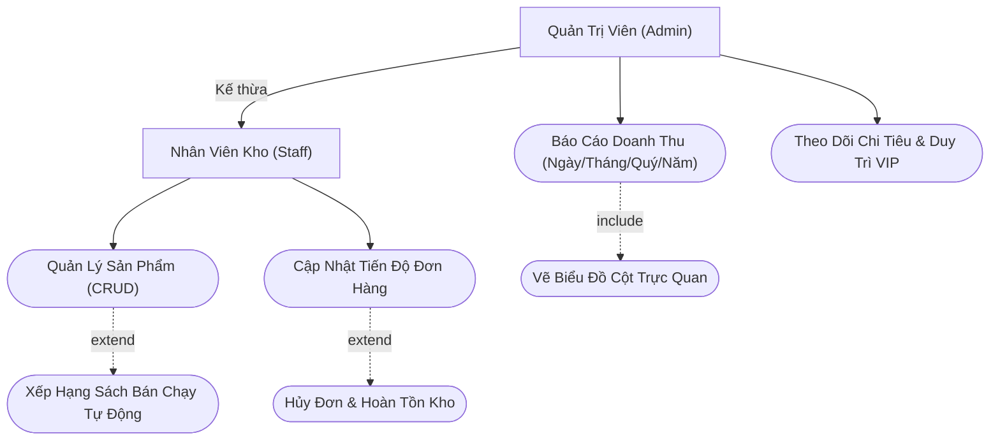

---

## 5. SƠ ĐỒ LUỒNG DỮ LIỆU (DATA FLOW DIAGRAM - DFD)

### 5.1. DFD Cấp 0 (Context Diagram - Sơ Đồ Ngữ Cảnh)

Sơ đồ thể hiện luồng vào/ra dữ liệu tổng thể giữa hệ thống phần mềm và các thực thể ngoại cảnh:

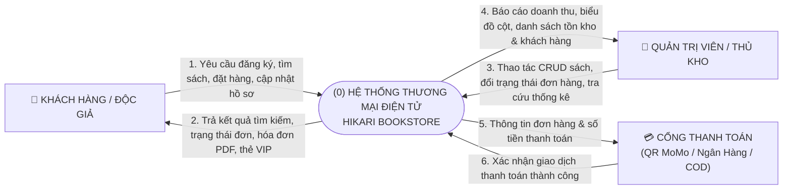

### 5.2. DFD Cấp 1 (Phân Rã Các Tiến Trình Luồng Dữ Liệu Nghiệp Vụ)

Phân rã chi tiết luồng dữ liệu tương tác giữa các tiến trình và các kho dữ liệu (Data Stores):

```mermaid
flowchart TD
    Customer["👤 Khách Hàng"]
    Admin["👑 Quản Trị Viên"]

    subgraph Data_Stores ["KHO DỮ LIỆU HỆ THỐNG (JSON DATABASE & STORAGE)"]
        D1[("D1: Bảng users (Tài khoản & Hồ sơ)")]
        D2[("D2: Bảng products (Kho sách & Tồn kho)")]
        D3[("D3: Bảng coupons (Mã ưu đãi)")]
        D4[("D4: Bảng orders (Hóa đơn & Đơn hàng)")]
        D5[("D5: LocalStorage (Phiên đăng nhập & Giỏ hàng)")]
    end

    P1(["1.0 Xác Thực & Phân Quyền"])
    P2(["2.0 Tra Cứu & Lọc Sách"])
    P3(["3.0 Quản Lý Giỏ Hàng & Mã Ưu Đãi"])
    P4(["4.0 Xử Lý Đặt Hàng & Xuất Hóa Đơn"])
    P5(["5.0 Quản Lý Hồ Sơ & Cấp VIP Theo Tháng"])
    P6(["6.0 Quản Trị Sản Phẩm & Kho Hàng"])
    P7(["7.0 Thống Kê & Báo Cáo Doanh Thu"])

    %% Luồng tiến trình 1
    Customer -->|Email, Mật khẩu| P1
    P1 <-->|Kiểm tra tài khoản| D1
    P1 -->|Lưu User Session| D5

    %% Luồng tiến trình 2
    Customer -->|Từ khóa, Thể loại, Tầm giá| P2
    P2 <-->|Đọc danh mục & thông tin sách| D2
    P2 -->|Danh sách tác phẩm đã lọc| Customer

    %% Luồng tiến trình 3
    Customer -->|Thêm sách, Mã voucher| P3
    P3 <-->|Lưu trữ giỏ hàng| D5
    P3 <-->|Kiểm tra giá trị voucher & điều kiện VIP| D3
    P3 -->|Tạm tính, Giảm giá, Tổng tiền| Customer

    %% Luồng tiến trình 4
    Customer -->|Địa chỉ nhận, Phương thức trả tiền| P4
    P4 -->|Ghi đơn hàng mới| D4
    P4 -->|Trừ số tồn kho stock, tăng sold| D2
    P4 -->|Xóa sạch giỏ hàng| D5
    P4 -->|Tạo hóa đơn VAT điện tử PDF| Customer

    %% Luồng tiến trình 5
    Customer -->|Cập nhật địa chỉ mặc định| P5
    P5 <-->|Lấy lịch sử đơn hàng để tính chi tiêu tháng| D4
    P5 -->|Cập nhật hạng VIP & Địa chỉ| D1
    P5 -->|Hiển thị tiến độ duy trì VIP tháng sau| Customer

    %% Luồng tiến trình 6 (Admin)
    Admin -->|Thêm / Sửa / Xóa tác phẩm, Đổi trạng thái đơn| P6
    P6 <-->|Cập nhật kho sách| D2
    P6 <-->|Cập nhật tiến trình đơn hàng| D4

    %% Luồng tiến trình 7 (Admin)
    Admin -->|Chọn chu kỳ (Ngày/Tháng/Quý/Năm)| P7
    P7 <-->|Tổng hợp doanh thu từ đơn hoàn thành| D4
    P7 -->|Vẽ biểu đồ cột trực quan & Chỉ số KPI| Admin
```

---

## 6. KIẾN TRÚC TỔNG THỂ HỆ THỐNG 3 TẦNG (3-TIER LAYERED ARCHITECTURE)

Hệ thống được tổ chức thành 3 tầng riêng biệt, kết nối lỏng lẻo (Loosely Coupled):

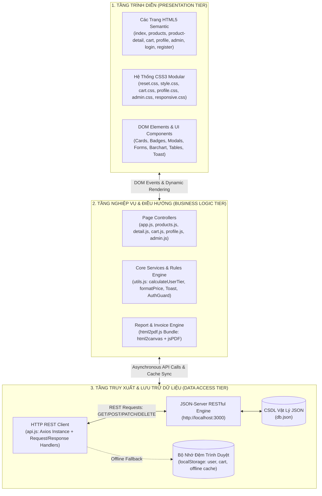

### Chi Tiết Nhiệm Vụ Từng Tầng:
1. **Tầng Trình Diễn (Presentation Tier):** Chịu trách nhiệm trực quan hóa giao diện người dùng, thu thập tương tác sự kiện (`click`, `input`, `submit`, `change`) và kết xuất (render) các phần tử DOM động.
2. **Tầng Nghiệp Vụ (Business Logic Tier):** Xử lý toàn bộ logic tính toán: Thuật toán lọc sản phẩm đa tiêu chí, tính toán giá trị giỏ hàng, xác thực điều kiện mã voucher (đặc biệt là mã `VIPMEMBER`), tính toán hạn mức nâng hạng và duy trì VIP theo tháng, tạo cấu trúc hóa đơn PDF.
3. **Tầng Dữ Liệu (Data Access Tier):** Quản lý việc kết nối, gửi nhận dữ liệu bất đồng bộ với Backend REST API thông qua Axios, đồng thời điều phối bộ nhớ đệm `localStorage` nhằm đảm bảo tính toàn vẹn dữ liệu ngoại tuyến.

---

## 7. PHÂN RÃ HỆ THỐNG & CẤU TRÚC MODULE (COMPONENT & CLASS DIAGRAM)

Toàn bộ logic của ứng dụng được phân rã thành **10 Module ES6 chuyên trách** nằm trong thư mục `js/`:

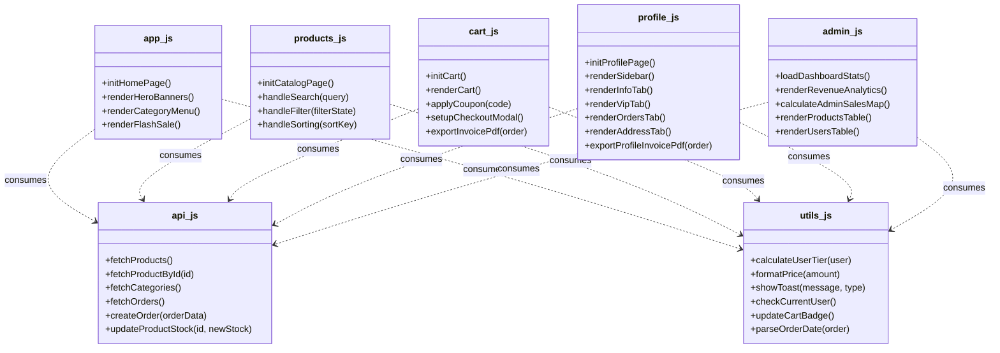

---

## 8. SƠ ĐỒ TRIỂN KHAI HỆ THỐNG PHẦN MỀM (DEPLOYMENT DIAGRAM)

Mô tả môi trường thực thi vật lý và phân bố thành phần ứng dụng trên máy trạm Client và Server phát triển:

```mermaid
flowchart LR
    subgraph Client_Node ["🖥️ THIẾT BỊ NGƯỜI DÙNG (CLIENT RUNTIME)"]
        subgraph Browser ["Web Browser (Chrome / Edge / Firefox)"]
            DOM_Render["Presentation Engine
(HTML5 + CSS3 + Flexbox/Grid)"]
            ES6_Engine["JavaScript V8 Engine
(ES6+ Modules: js/*.js)"]
            Browser_Storage[("Web Storage
(localStorage: user, cart, offline cache)")]
            Canvas_Worker["PDF Generator Sandbox
(html2canvas + jsPDF)"]
        end
    end

    subgraph Host_Server ["💻 MÁY CHỦ DỊCH VỤ (DEVELOPMENT ENVIRONMENT)"]
        subgraph Vite_Server ["Vite Dev Server (Port 5173)"]
            HMR_Server["Hot Module Replacement (HMR)"]
            Static_Bundler["Rollup Bundler Engine"]
        end

        subgraph Mock_Backend ["JSON-Server API Service (Port 3000)"]
            REST_Endpoints["Express-based Router
(/products, /orders, /users, /coupons)"]
            JSON_Driver["JSON File Driver (Lowdb Engine)"]
        end

        subgraph Local_Storage_Disk ["Hệ Thống Tệp Cục Bộ (Physical Disk)"]
            Source_Files["Mã Nguồn (HTML, CSS, JS, Assets)"]
            Database_File[("Tệp CSDL Vật Lý
(db.json)")]
        end
    end

    ES6_Engine <-->|DOM Events & UI Updates| DOM_Render
    ES6_Engine <-->|Read / Write Synchronous| Browser_Storage
    ES6_Engine -->|Canvas Render to Document| Canvas_Worker

    DOM_Render <-->|HTTP / WebSocket HMR:5173| Vite_Server
    ES6_Engine <-->|RESTful Ajax HTTP:3000 (Axios)| Mock_Backend

    Vite_Server <--> Source_Files
    Mock_Backend <--> JSON_Driver
    JSON_Driver <--> Database_File
```

---

## 9. SƠ ĐỒ MÁY TRẠNG THÁI NGHIỆP VỤ (STATE MACHINE DIAGRAMS)

### 9.1. Sơ Đồ Trạng Thái Vòng Đời Đơn Hàng (Order Lifecycle)

Đơn hàng vận hành tuần tự qua 4 trạng thái chính kèm cơ chế hủy đơn và tự động hoàn trả số lượng tồn kho:

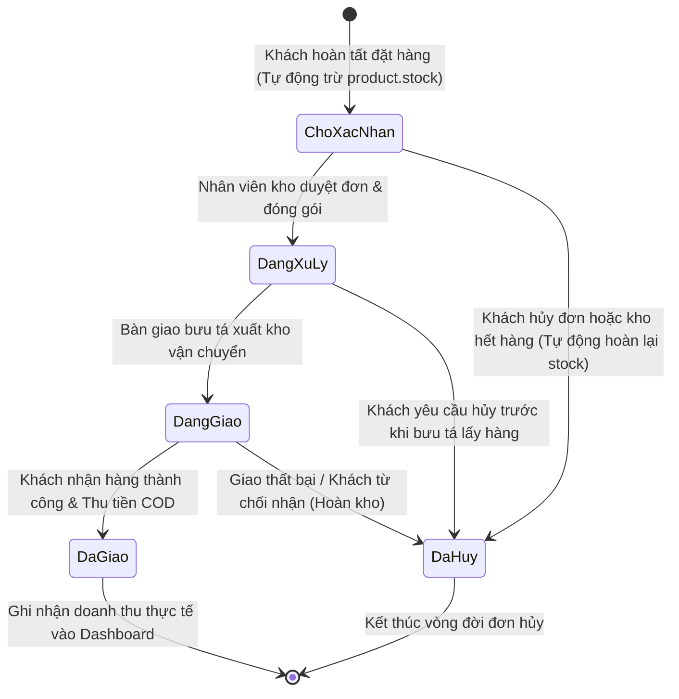

### 9.2. Sơ Đồ Trạng Thái Chu Kỳ Tích Lũy & Duy Trì VIP Theo Tháng

Mô hình nâng hạng và điều kiện duy trì đặc quyền VIP độc quyền theo từng chu kỳ tháng:

```mermaid
stateDiagram-v2
    [*] --> Member_Normal: Đăng ký tài khoản mới

    Member_Normal --> Member_Normal: Chi tiêu trong tháng hiện tại < 250.000đ
    Member_Normal --> VIP_Active: Chi tiêu tháng hiện tại >= 250.000đ
(Kích hoạt VIP ngay lập tức & Mở khóa voucher VIPMEMBER -15%)

    state VIP_Active {
        [*] --> VIP_Evaluating: Bắt đầu tháng mới
        VIP_Evaluating --> VIP_Maintained: Chi tiêu trong tháng mới đạt >= 250.000đ
(Đạt chỉ tiêu duy trì)
        VIP_Evaluating --> VIP_AtRisk: Chi tiêu trong tháng mới < 250.000đ
(Cảnh báo nguy cơ mất hạng)
    }

    VIP_Maintained --> VIP_Active: Sang tháng tiếp theo (Giữ vững quyền VIP & Reset chỉ tiêu tháng mới về 0đ)
    VIP_AtRisk --> Member_Normal: Hết tháng không đạt 250.000đ
(Hạ cấp về Thành viên thường)
    VIP_AtRisk --> VIP_Maintained: Khách mua bổ sung đủ >= 250.000đ trước khi hết tháng
```

---

## 10. CÁC MẪU THIẾT KẾ PHẦN MỀM ỨNG DỤNG (SOFTWARE DESIGN PATTERNS)

### 10.1. Mẫu Thiết Kế Module (Module Pattern)
- **Cơ chế:** Sử dụng cú pháp chuẩn của ECMAScript 6 (`export` / `import`) với `<script type="module">`.
- **Lợi ích:** Đóng gói phạm vi biến (Encapsulation), triệt tiêu hoàn toàn ô nhiễm biến toàn cục (`global scope pollution`), cho phép tái sử dụng các hàm tiện ích (`utils.js`) và cổng API (`api.js`) xuyên suốt toàn bộ các trang web.

### 10.2. Mẫu Thiết Kế Mặt Tiền (Facade Pattern)
- **Ứng dụng:** Thể hiện rõ nét trong module `js/api.js`.
- **Cơ chế:** `api.js` cung cấp một giao diện lập trình đơn giản (ví dụ: `fetchProducts()`). Các module phía ngoài (như `app.js`, `products.js`) chỉ cần gọi hàm này mà không cần quan tâm đến sự phức tạp bên trong: Liệu yêu cầu đang được gửi qua Axios, Fetch API, hay đang tự động chuyển hướng đọc file tĩnh `db.json` dự phòng khi mất kết nối mạng.

```javascript
// Facade Pattern: Che giấu toàn bộ logic kiểm tra mạng và fallback
export const fetchProducts = async () => {
  try {
    const res = await axios.get(`${API_BASE_URL}/products`);
    return res.data;
  } catch (err) {
    return await fallbackLocalDb('products');
  }
};
```

### 10.3. Mẫu Thiết Kế Hướng Sự Kiện (Observer / Event-Driven Pattern)
- **Cơ chế:** Đăng ký và lắng nghe các sự kiện DOM (`click`, `input`, `change`, `submit`) theo cơ chế Event Delegation trên các container cha.
- **Ứng dụng:**
  - Lắng nghe thay đổi số lượng trong giỏ hàng để tự động kích hoạt chuỗi tính toán lại giá trị tạm tính (`subtotal`), phí ship (`shippingFee`), chiết khấu voucher (`discount`) và vẽ lại giao diện.
  - Sau khi đặt hàng thành công, kích hoạt hàm `updateCartBadge()` để thông báo cập nhật số lượng hiển thị trên Header toàn hệ thống.

### 10.4. Mẫu Quản Lý Trạng Thái Cục Bộ (State Management Pattern)
- **Cơ chế:** Mỗi trang giao diện duy trì một đối tượng `state` duy nhất đóng vai trò là "Single Source of Truth":
```javascript
// Quản lý trạng thái tập trung trong admin.js
const state = {
  orders: [],
  products: [],
  users: [],
  selectedPeriod: 'month',  // 'day' | 'month' | 'quarter' | 'year'
  activeGroupFilter: null
};
```
- **Lợi ích:** Khi người dùng thay đổi bộ lọc hoặc tương tác trên biểu đồ, chỉ cần thay đổi thuộc tính trong `state` rồi gọi hàm render tương ứng, loại bỏ tình trạng dữ liệu hiển thị không đồng nhất trên các bảng.

### 10.5. Mẫu Chiến Lược Tính Toán (Strategy Pattern)
- **Ứng dụng:** Được áp dụng trong module `cart.js` khi xử lý nhiều loại mã giảm giá khác nhau:
  - *Chiến lược 1 (`percent`):* `discount = Math.round(subtotal * (percent / 100))`
  - *Chiến lược 2 (`fixed`):* `discount = fixedAmount`
  - *Chiến lược 3 (`new_products`):* Chỉ duyệt và tính chiết khấu trên các sản phẩm có nhãn `isNew: true`.
  - *Chiến lược 4 (`vip`):* Kiểm tra điều kiện qua `calculateUserTier()`, nếu đạt chuẩn VIP thì áp dụng chính sách giảm 15% tổng hóa đơn.

---

## 11. KIẾN TRÚC ĐA TRANG (MULTI-PAGE APPLICATION - MPA) & TỐI ƯU HÓA VITE

Mặc dù tuân thủ nguyên tắc không sử dụng SPA framework, dự án vẫn đạt được hiệu năng tải trang vượt trội nhờ kiến trúc **Multi-Page App (MPA)** được biên dịch bởi **Vite v6**.

### 11.1. Cấu Hình Rollup Multi-Entry (`vite.config.js`)
Hệ thống cấu hình đầy đủ các entry points cho từng trang HTML:
```javascript
import { resolve } from 'path';
import { defineConfig } from 'vite';

export default defineConfig({
  build: {
    rollupOptions: {
      input: {
        main: resolve(__dirname, 'index.html'),
        products: resolve(__dirname, 'products.html'),
        cart: resolve(__dirname, 'cart.html'),
        profile: resolve(__dirname, 'profile.html'),
        admin: resolve(__dirname, 'admin.html'),
        login: resolve(__dirname, 'login.html'),
        register: resolve(__dirname, 'register.html'),
        detail: resolve(__dirname, 'product-detail.html')
      }
    }
  }
});
```

### 11.2. Lợi Điểm Của Giải Pháp:
1. **Phân Tách Mã Nguồn (Code-Splitting):** Mỗi trang chỉ tải đúng đoạn mã JavaScript và tệp CSS cần thiết cho trang đó, giảm dung lượng tải ban đầu (Initial Bundle Size).
2. **SEO Tự Nhiên & Thân Thiện Tìm Kiếm:** Mỗi trang sở hữu URL độc lập (`/products.html`, `/profile.html`), tiêu đề `<title>` và thẻ `<meta description>` riêng biệt, hỗ trợ tối đa việc thu thập dữ liệu của công cụ tìm kiếm.

---

## 12. KIẾN TRÚC PHÂN QƯYỀN & BẢO MẬT ỨNG DỤNG (SECURITY & RBAC ARCHITECTURE)

### 12.1. Mô Hình Kiểm Soát Truy Cập Dựa Trên Vai Trò (Role-Based Access Control - RBAC)

Hệ thống phân cấp quyền hạn rõ ràng thành 3 cấp độ:

```mermaid
flowchart TD
    Guest["Khách Vãng Lai (Chưa Đăng Nhập)"]
    Customer["Độc Giả (Role: 'customer')"]
    Staff["Nhân Viên Kho (Role: 'staff')"]
    Admin["Quản Trị Viên (Role: 'admin')"]

    Guest -->|Được phép| G1["Xem Trang Chủ, Kệ Sách, Chi Tiết"]
    Guest -->|Được phép| G2["Thêm Sách Vào Giỏ Hàng Tạm Thời"]
    Guest -.->|Bị chặn| G3["Thanh Toán (Bắt buộc đăng nhập)"]

    Customer -->|Kế thừa Guest & Được phép| C1["Đặt Hàng & Thanh Toán"]
    Customer -->|Được phép| C2["Quản Lý Hồ Sơ & Thẻ VIP (profile.html)"]
    Customer -->|Được phép| C3["Xuất Hóa Đơn VAT Điện Tử File PDF"]
    Customer -.->|Bị chặn| C4["Truy cập Trang Quản Trị (admin.html)"]

    Staff -->|Được phép| S1["Truy Cập admin.html (Quản lý kho hàng)"]
    Staff -->|Được phép| S2["Theo Dõi & Xử Lý Đơn Hàng"]
    Staff -.->|Hạn chế| S3["Xóa dữ liệu CSDL / Cấu hình hệ thống"]

    Admin -->|Toàn Quyền Toàn Hệ Thống| A1["Xem Toàn Bộ Dashboard Doanh Thu & Biểu Đồ"]
    Admin -->|Toàn Quyền| A2["Thêm / Sửa / Xóa Tác Phẩm Khỏi CSDL"]
    Admin -->|Toàn Quyền| A3["Quản Lý Danh Sách Khách Hàng & Duy Trì VIP"]
```

### 12.2. Kiểm Soát Chặn Tuyến Phía Client (Client-Side Route Guarding)
Tại đầu trang `admin.html`, một đoạn mã kiểm tra quyền hạn (Auth Guard) được kích hoạt ngay trước khi giao diện được vẽ:
```javascript
const user = JSON.parse(localStorage.getItem('user'));
if (!user || (user.role !== 'admin' && user.role !== 'staff')) {
  alert('⚠️ Khu vực giới hạn: Bạn không có quyền truy cập trang quản trị!');
  window.location.href = 'index.html';
}
```

### 12.3. Phòng Ngừa Tấn Công & Xác Thực Form
- **Xác thực dữ liệu bắt buộc:** Mọi biểu mẫu (Đăng ký, Đăng nhập, Thanh toán, Cập nhật thông tin) đều được kiểm tra chặt chẽ bằng Regular Expression cho số điện thoại (`/^(0|\+84)[3|5|7|8|9][0-9]{8}$/`) và email chuẩn RFC 5322.
- **Bảo vệ toàn vẹn đơn hàng:** Trước khi tạo đơn, hệ thống đối chiếu số lượng tồn kho `product.stock >= item.quantity` trực tiếp trên máy chủ để loại trừ hoàn toàn nguy cơ âm kho khi nhiều người cùng đặt hàng.

---

## 13. CHIẾN LƯỢC CHỊU LỖI & TÍNH SẴN SÀNG CAO (HIGH AVAILABILITY & RESILIENCE)

Để đảm bảo buổi demo bảo vệ đồ án diễn ra hoàn hảo không gặp sự cố về hạ tầng mạng, Hikari BookStore áp dụng cơ chế **Phục hồi dữ liệu 3 lớp (Triple-Layer Fallback Strategy)**:

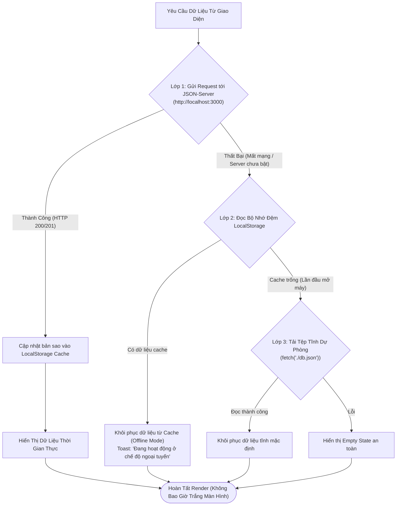

---

## 14. KỸ THUẬT CHUẨN HÓA KHUNG NHÌN KHI XUẤT PDF (PDF VIEWPORT NORMALIZATION)

Nhằm giải quyết triệt để lỗi file PDF bị trắng hoặc đè chữ khi khách hàng cuộn trang thanh toán, hệ thống áp dụng kỹ thuật 3 bước:
1. **Khử Tọa Độ Fixed:** Template in `#invoicePrintTemplate` sử dụng chiều rộng chuẩn A4 in ấn `750px` với `margin: 25px auto`, không dùng `position: fixed`.
2. **Đồng Bộ Viewport:** Kích hoạt lệnh `window.scrollTo({ top: 0, behavior: 'instant' })` trước khi thư viện `html2canvas` chụp màn hình, đảm bảo tọa độ $Y = 0$.
3. **Cấu Hình Ngắt Trang Chống Cắt Con Dấu:** Sử dụng thuộc tính `pagebreak: { mode: ['avoid-all', 'css', 'legacy'] }` kết hợp CSS `break-inside: avoid` để con dấu đỏ thủ kho và chữ ký luôn nằm trọn vẹn trên cùng một trang in.

---

> ✍️ **Biên soạn & Thiết kế kỹ thuật bởi:** Nhóm phát triển dự án Hikari BookStore  
> 📌 **Tài liệu thuộc bộ hồ sơ đồ án:** Môn Lập trình JavaScript (Vanilla JS & ES6+)  
> 📅 **Năm thực hiện:** 2026
