# 🔄 TÀI LIỆU QUY TRÌNH NGHIỆP VỤ HỆ THỐNG (WORKFLOW SPECIFICATION)
## DỰ ÁN: HIKARI BOOKSTORE - THƯƠNG MẠI ĐIỆN TỬ MANGA & LIGHT NOVEL
> **Môn học:** Đồ án kết thúc học phần Lập trình JavaScript  
> **Ngôn ngữ:** JavaScript thuần (Vanilla JS) & ES6+  
> **Định dạng:** Markdown chuẩn kết hợp sơ đồ trực quan Mermaid  

---

## 📑 MỤC LỤC CÁC QUY TRÌNH (WORKFLOWS)
1. [Workflow 1: Đăng Ký Tài Khoản & Đăng Nhập Phân Quyền (RBAC)](#workflow-1-đăng-ký-tài-khoản--đăng-nhập-phân-quyền-rbac)
2. [Workflow 2: Khám Phá Sách, Tìm Kiếm & Lọc Đa Tiêu Chí](#workflow-2-khám-phá-sách-tìm-kiếm--lọc-đa-tiêu-chí)
3. [Workflow 3: Xem Chi Tiết Tác Phẩm & Thêm Vào Giỏ Hàng](#workflow-3-xem-chi-tiết-tác-phẩm--thêm-vào-giỏ-hàng)
4. [Workflow 4: Quản Lý Giỏ Hàng & Kiểm Tra Voucher Đa Dạng](#workflow-4-quản-lý-giỏ-hàng--kiểm-tra-voucher-đa-dạng)
5. [Workflow 5: Đặt Hàng & Cơ Chế Linh Hoạt Địa Chỉ Giao Hàng](#workflow-5-đặt-hàng--cơ-chế-linh-hoạt-địa-chỉ-giao-hàng)
6. [Workflow 6: Xuất Hóa Đơn VAT Điện Tử File PDF](#workflow-6-xuất-hóa-đơn-vat-điện-tử-file-pdf)
7. [Workflow 7: Thuật Toán Thăng Hạng & Duy Trì Cấp Bậc VIP Theo Tháng](#workflow-7-thuật-toán-thăng-hạng--duy-trì-cấp-bậc-vip-theo-tháng)
8. [Workflow 8: Quản Lý Trang Hồ Sơ Độc Giả (Profile Hub 4 Tabs)](#workflow-8-quản-lý-trang-hồ-sơ-độc-giả-profile-hub-4-tabs)
9. [Workflow 9: Báo Cáo Doanh Thu & Biểu Đồ Cột Trực Quan (Admin)](#workflow-9-báo-cáo-doanh-thu--biểu-đồ-cột-trực-quan-admin)
10. [Workflow 10: Quản Lý Kho Hàng & Tự Động Xếp Hạng Sách Bán Chạy Nhất](#workflow-10-quản-lý-kho-hàng--tự-động-xếp-hạng-sách-bán-chạy-nhất)
11. [Workflow 11: Quản Trị Khách Hàng & Theo Dõi Trạng Thái Duy Trì VIP](#workflow-11-quản-trị-khách-hàng--theo-dõi-trạng-thái-duy-trì-vip)

---

## WORKFLOW 1: ĐĂNG KÝ TÀI KHOẢN & ĐĂNG NHẬP PHÂN QUYỀN (RBAC)

### 1.1. Mục Tiêu
Đảm bảo xác thực danh tính người dùng an toàn, kiểm tra dữ liệu bằng Regular Expression (Regex), chống trùng lặp tài khoản và phân quyền rõ ràng giữa `customer`, `staff` và `admin`.

### 1.2. Sơ Đồ Quy Trình (Sequence Diagram)
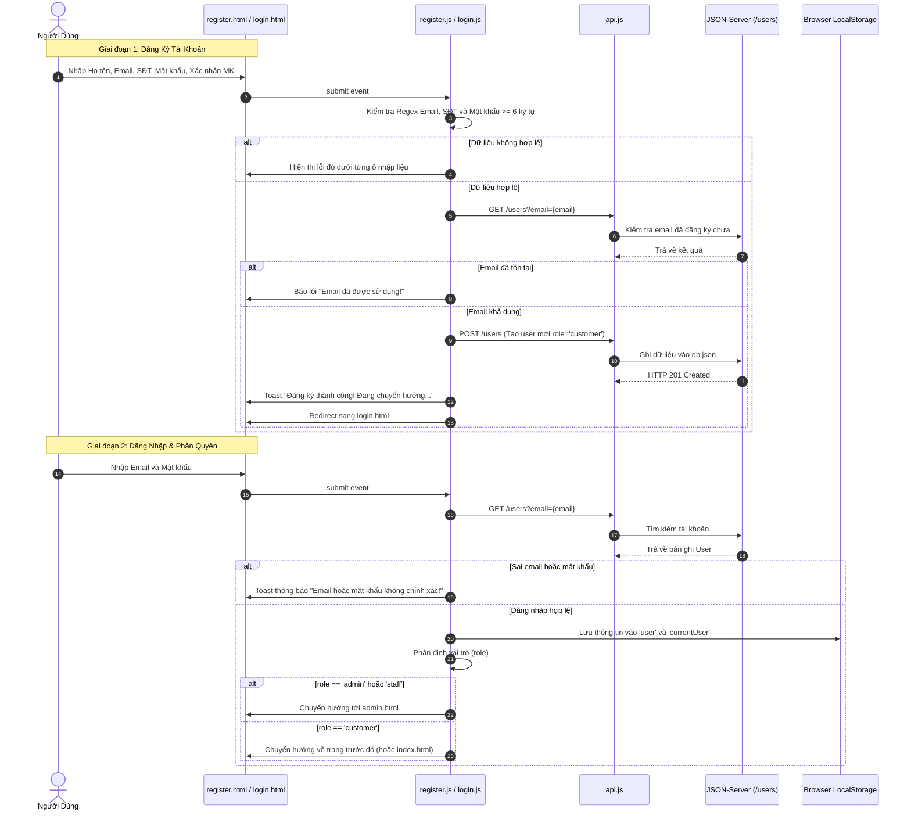

---

## WORKFLOW 2: KHÁM PHÁ SÁCH, TÌM KIẾM & LỌC ĐA TIÊU CHÍ

### 2.1. Mục Tiêu
Cung cấp trải nghiệm tìm kiếm tức thì và lọc đa chiều song song (thể loại, tầm giá, trạng thái sách hot/mới, sắp xếp) trên `products.html` và `index.html`.

### 2.2. Sơ Đồ Quy Trình (Flowchart)
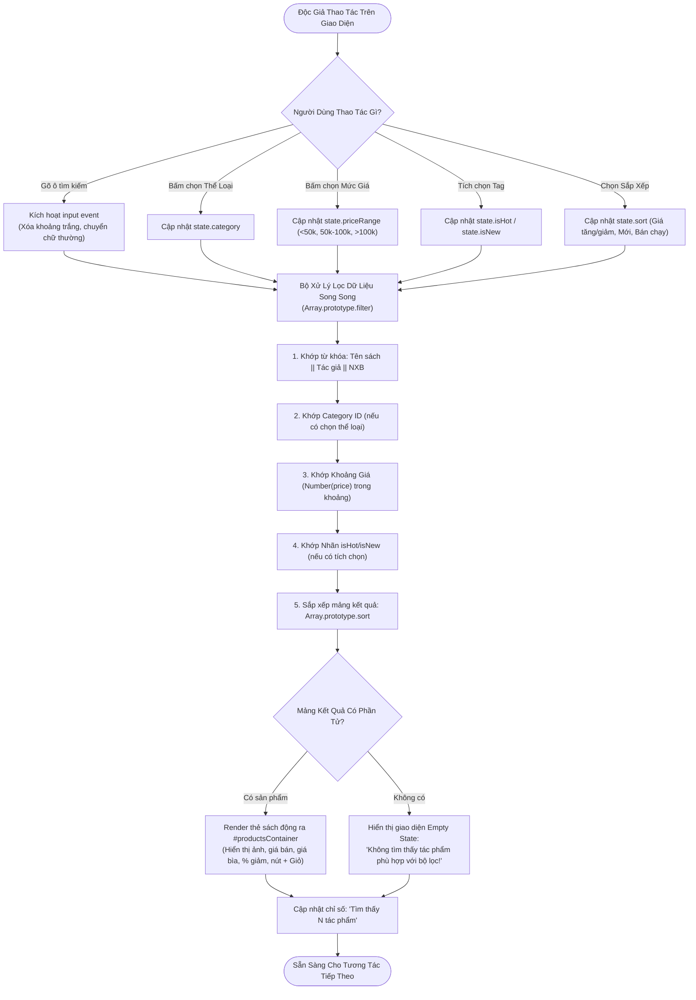

---

## WORKFLOW 3: XEM CHI TIẾT TÁC PHẨM & THÊM VÀO GIỎ HÀNG

### 3.1. Mục Tiêu
Hiển thị thông số chi tiết tác phẩm, kiểm soát số lượng mua theo tồn kho thực tế, cập nhật giỏ hàng đa nguồn (LocalStorage + Server API) và làm mới số lượng đếm trên Header badge.

### 3.2. Sơ Đồ Quy Trình (Sequence Diagram)
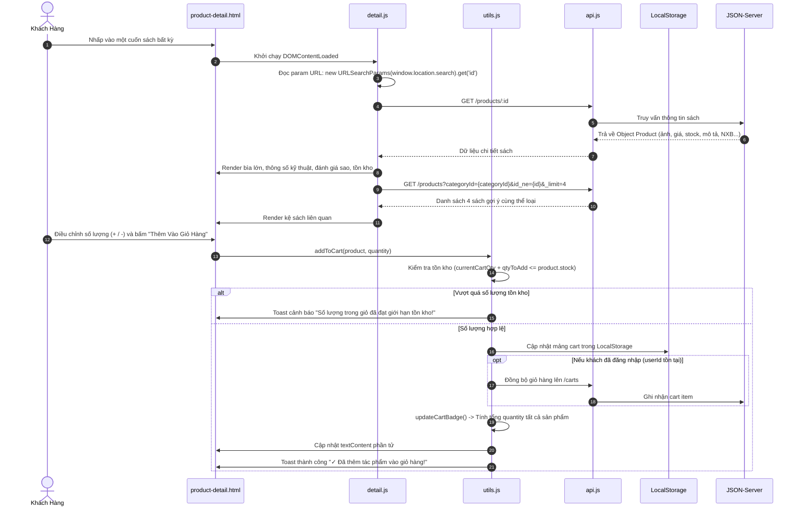

---

## WORKFLOW 4: QUẢN LÝ GIỎ HÀNG & KIỂM TRA VOUCHER ĐA DẠNG

### 4.1. Mục Tiêu
Cập nhật số lượng sách, xóa sản phẩm, tính toán giá trị tạm tính, phí vận chuyển và áp dụng chính xác các quy tắc voucher (đặc biệt là mã `VIPMEMBER` giảm 15% cho thành viên VIP).

### 4.2. Sơ Đồ Quy Trình (Flowchart)
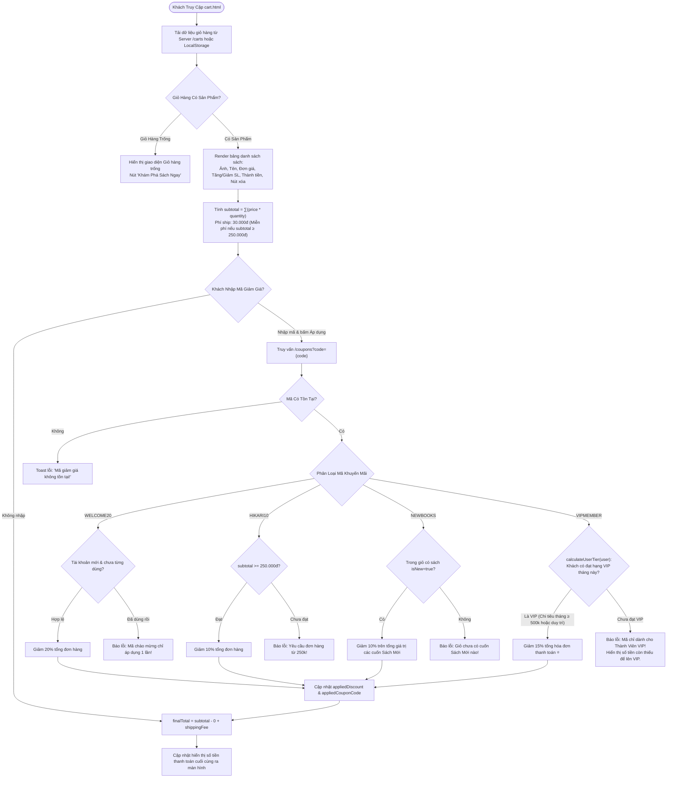

---

## WORKFLOW 5: ĐẶT HÀNG & CƠ CHẾ LINH HOẠT ĐỊA CHỈ GIAO HÀNG

### 5.1. Mục Tiêu
Đảm bảo khóa bảo mật đăng nhập, hỗ trợ tự động điền địa chỉ mặc định từ trang Hồ sơ, cho phép giao đến địa chỉ khác cho riêng đơn hàng này và tùy chọn cập nhật địa chỉ mới làm mặc định.

### 5.2. Sơ Đồ Quy Trình (Sequence Diagram)
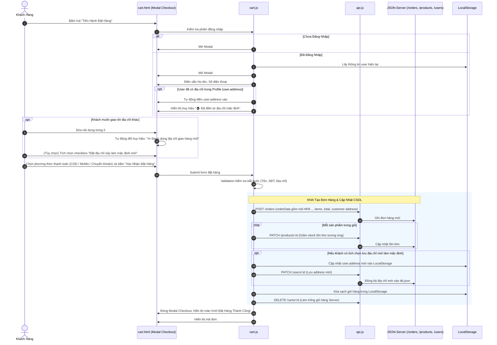

---

## WORKFLOW 6: XUẤT HÓA ĐƠN VAT ĐIỆN TỬ FILE PDF

### 6.1. Mục Tiêu
Xuất file chứng từ hóa đơn PDF có đầy đủ tư cách pháp lý bảo hành đổi trả, chuẩn kích thước A4, hình ảnh sắc nét, con dấu xuất kho đỏ và không bao giờ bị lỗi trang trắng.

### 6.2. Sơ Đồ Quy Trình (Flowchart)
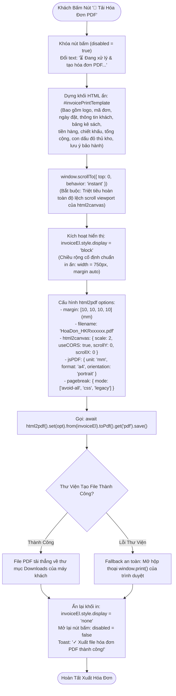

---

## WORKFLOW 7: THUẬT TOÁN THĂNG HẠNG & DUY TRÌ CẤP BẬC VIP THEO THÁNG

### 7.1. Mục Tiêu
Thuật toán trung tâm trong `utils.js` tự động tính toán cấp bậc độc giả, bảo lưu danh hiệu từ tháng trước, theo dõi hạn mức duy trì và trả về dữ liệu tiến trình cho giao diện Profile & Admin.

### 7.2. Sơ Đồ Quy Trình (Flowchart)
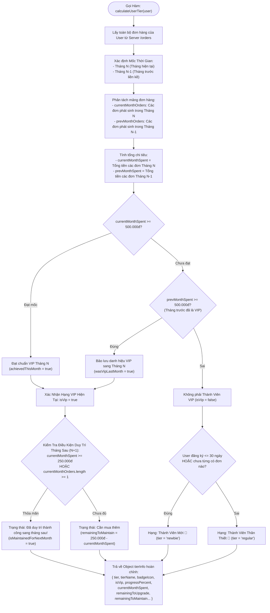

---

## WORKFLOW 8: QUẢN LÝ TRANG HỒ SƠ ĐỘC GIẢ (PROFILE HUB 4 TABS)

### 8.1. Mục Tiêu
Cung cấp trang quản trị tài khoản độc lập `profile.html` thay thế hoàn toàn popup modal, chia thành 4 tab nghiệp vụ chuyên biệt với thanh điều hướng trực quan.

### 8.2. Sơ Đồ Quy Trình (Flowchart)
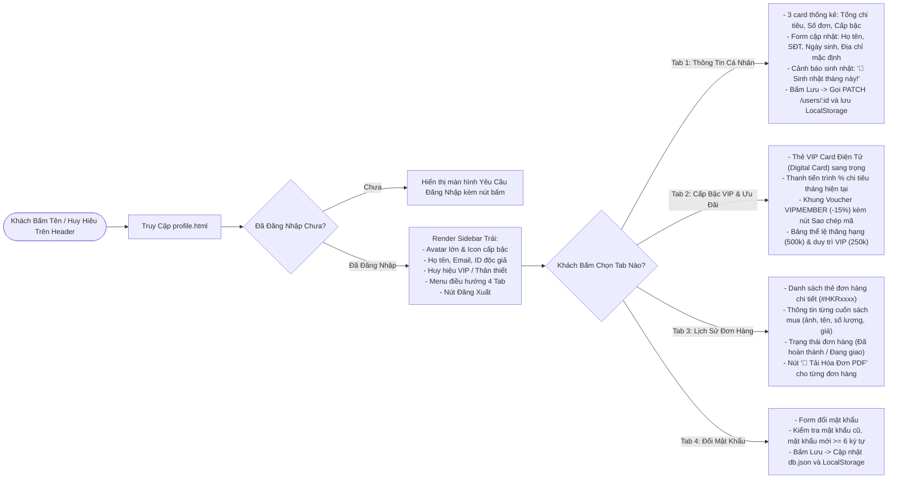

---

## WORKFLOW 9: BÁO CÁO DOANH THU & BIỂU ĐỒ CỘT TRỰC QUAN (ADMIN)

### 9.1. Mục Tiêu
Cung cấp cho Ban quản trị cái nhìn toàn diện về hiệu quả kinh doanh, tổng hợp doanh thu và số lượng đơn hàng theo các mốc chu kỳ thời gian linh hoạt (Ngày, Tháng, Quý, Năm).

### 9.2. Sơ Đồ Quy Trình (Sequence Diagram)
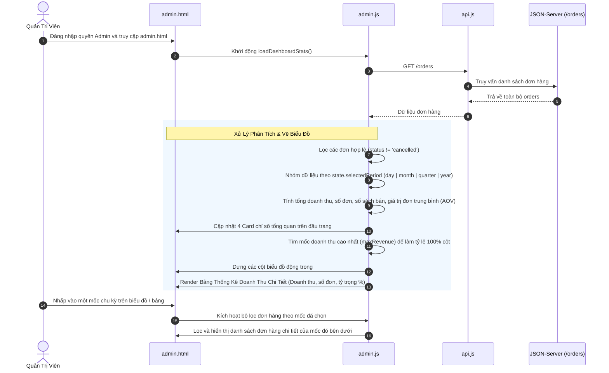

---

## WORKFLOW 10: QUẢN LÝ KHO HÀNG & TỰ ĐỘNG XẾP HẠNG SÁCH BÁN CHẠY NHẤT

### 10.1. Mục Tiêu
Tính toán chính xác số lượng sách bán ra thực tế dựa trên các hóa đơn đã giao, tự động gắn nhãn `🔥 TOP BÁN CHẠY` và quản lý kho sách bằng đầy đủ thao tác CRUD.

### 10.2. Sơ Đồ Quy Trình (Flowchart)
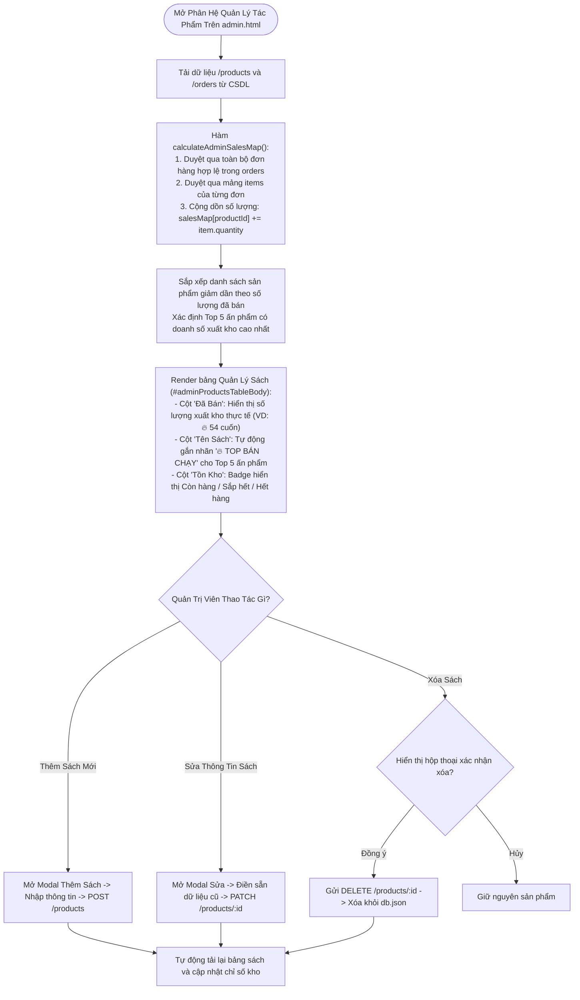

---

## WORKFLOW 11: QUẢN TRỊ KHÁCH HÀNG & THEO DÕI TRẠNG THÁI DUY TRÌ VIP

### 11.1. Mục Tiêu
Theo dõi danh sách độc giả đã đăng ký, đo lường tổng chi tiêu trọn đời, chi tiêu trong tháng hiện tại và trạng thái bảo lưu danh hiệu VIP sang tháng tiếp theo.

### 11.2. Sơ Đồ Quy Trình (Sequence Diagram)
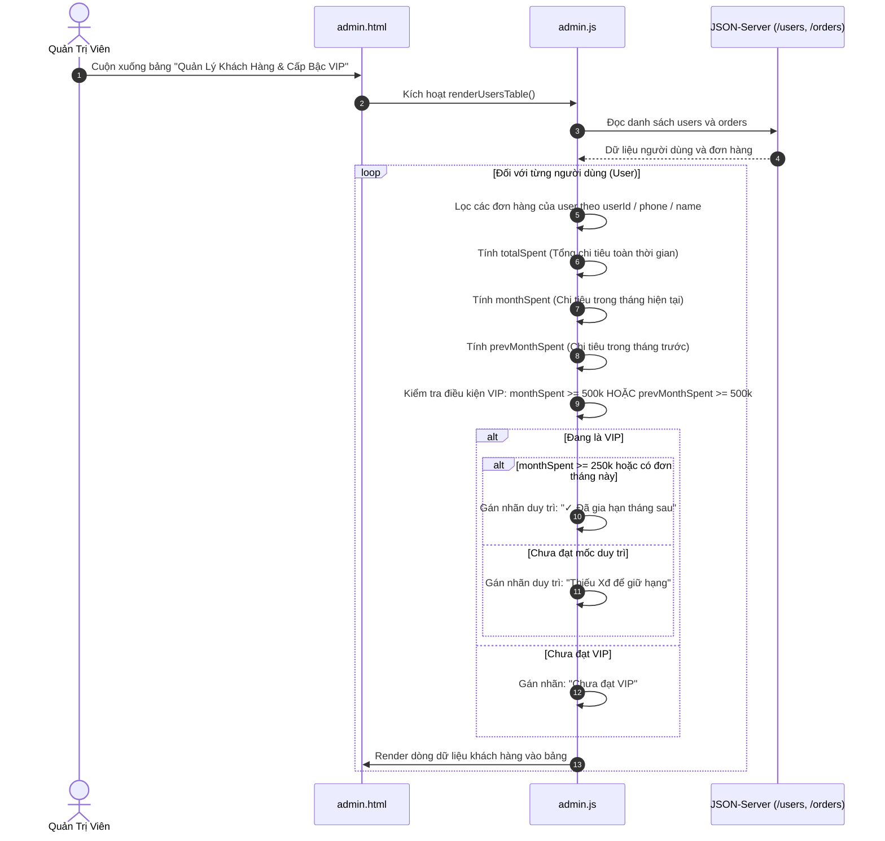

---

> ✍️ **Biên soạn & Thiết kế quy trình bởi:** Đội ngũ phát triển dự án Hikari BookStore  
> 📌 **Tài liệu thuộc bộ hồ sơ đồ án:** Môn Lập trình JavaScript (Vanilla JS & ES6+)

